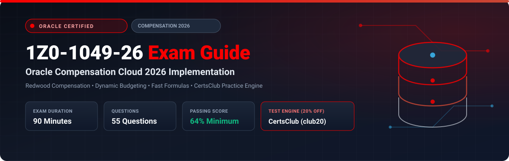

  

# Oracle Compensation Cloud 2026 Implementation Professional (1Z0-1049-26) Exam Study Guide & Practice Test Resource Portal

[-f80000?style=for-the-badge&logo=oracle&logoColor=white)](https://education.oracle.com/)
[-f80000?style=for-the-badge&logo=oracle)](https://education.oracle.com/)

[-28a745?style=for-the-badge&logo=shield)](https://www.certsclub.com/oracle/)

---

## 1. Exam Overview & Candidate Profile

The **Oracle Compensation Cloud 2026 Implementation Professional (1Z0-1049-26)** exam validates that an implementation consultant possesses the modern competencies needed to deliver Oracle Fusion Cloud Compensation with Redwood user experience. The exam evaluates expertise in Base Pay structures, Progression Grade Ladders, Individual Compensation Plans, Workforce Compensation annual modeling cycles, and automated posting to Core HR and Global Payroll.

Passing 1Z0-1049-26 awards the **Oracle Compensation Cloud 2026 Certified Implementation Professional** credential.

### Target Candidate Profile & Career Roles
* **Lead Compensation Functional Implementers**
* **Total Rewards Solutions Consultants**
* **HCM Cloud Compensation Architects**

---

## 2. Key Exam Specifications

| Parameter | Official Specification |
| :--- | :--- |
| **Exam Code** | 1Z0-1049-26 |
| **Exam Title** | Oracle Compensation Cloud 2026 Implementation Professional |
| **Associated Credential** | Oracle Compensation Cloud 2026 Certified Implementation Professional |
| **Duration** | 90 Minutes |
| **Number of Questions** | 55 Questions |
| **Passing Score** | 64% |
| **Question Format** | Multiple Choice (Single and Multiple Select) |
| **Delivery Vendor** | Pearson VUE / Oracle University Online Remote Proctoring |
| **Recommended Practice Test Engine** | **[1Z0-1049-26 Practice Test - CertsClub](https://www.certsclub.com/oracle/)** (Coupon: `club20` for 20% off) |

---

## 3. Official Blueprint & Exam Domain Breakdown

| Domain Code | Domain Title | Weighting | Key Competencies Covered |
| :--- | :--- | :---: | :--- |
| **1.0** | **Base Pay & Salary Administration (Redwood)** | **20%** | Salary Basis, Grade rates, Progression Grade Ladders with automated rate advancement. |
| **2.0** | **Individual Compensation Plans & Self-Service** | **20%** | Setting up ICPs in Redwood, Approvals, Variable compensation, One-time bonuses. |
| **3.0** | **Workforce Compensation & Budget Modeling** | **30%** | Plan cycles, Dynamic worksheet layouts, Budget allocation modeling, Alerts, Approvals. |
| **4.0** | **Total Rewards & Statement Generation** | **15%** | Total Compensation Statements, Visual rewards graphs, Delivery options. |
| **5.0** | **Fast Formulas, Integration & Processing** | **15%** | Compensation Default and Override Fast Formulas, Post-cycle HR and Payroll transfers. |

---

## 4. Scenario-Based Demo Question & Explanation

### Question 1: Progression Grade Ladder Automation
**Scenario:** A company configures Progression Grade Ladders to automatically promote employees to the next grade step upon reaching their annual service anniversary.

Which scheduled process must be executed to identify eligible workers and update their salary rates?

A) Run the **Run Progression Grade Ladders** process.  
B) Generate Time Cards.  
C) Synchronize Person Assignments from Position.  
D) Calculate Accruals.  

**Correct Answer:** **A**

**Detailed Explanation:**
* In Oracle Fusion HCM, the **Run Progression Grade Ladders** scheduled process evaluates worker eligibility rules, detects service milestones, advances employees to the next step on the ladder, and updates their salary records automatically.

---

## 5. Recommended Preparation Strategy & Practice Testing Engine

1. **Practice Redwood Compensation Setup:** Configure salary bases and test manager compensation allocation worksheets.
2. **Practice with Full-Length Mock Exams:** Use **[CertsClub Oracle 1Z0-1049-26 Practice Tests](https://www.certsclub.com/oracle/)**.
   * Up-to-date with 2026 objectives and Redwood features.
   * Enter discount coupon code **`club20`** at checkout on [CertsClub](https://www.certsclub.com/oracle/) for an immediate 20% discount.

---

## 6. Official Documentation & References

* [Oracle Fusion Cloud Compensation 2026 Documentation](https://docs.oracle.com/en/cloud/saas/human-resources/compensation/)
* [Oracle University 1Z0-1049-26 Exam Details](https://education.oracle.com/)
* [CertsClub 1Z0-1049-26 Practice Engine](https://www.certsclub.com/oracle/)
